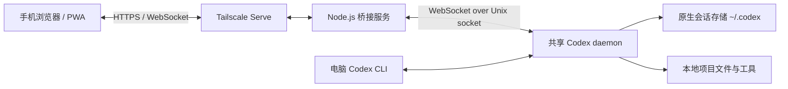

# Codex Mobile

通过手机浏览器连接 Ubuntu 上的 Codex，随时记录想法、编写代码和运行实验。

Codex Mobile 提供适配手机的聊天界面，并连接电脑上的共享 Codex 后台。手机与电脑 CLI 使用同一套原生会话，代码和实验文件保存在电脑上。项目采用 React + TypeScript + Node.js，无需额外部署应用数据库、任务队列或云服务器。

> 本项目是独立的第三方客户端，与 OpenAI 无隶属关系。当前主要面向个人使用，部署目标为 Ubuntu 24.04，移动端通过浏览器或 PWA 访问。

## 功能

- **按工作区组织会话**：先选择电脑上的目录，侧边栏显示该目录的历史会话；工作区分别保存草稿和最近打开的会话。
- **手机与电脑共享历史**：连接同一个 Codex daemon，使用原生会话 ID 继续已有对话。
- **模型与推理强度选择**：动态获取模型列表及其支持的 reasoning effort，修改从下一条消息生效。
- **执行过程可见**：流式 Markdown、代码块、表格、命令输出、文件差异和执行计划。
- **长会话快速跳转**：会话区右下角的按钮根据浏览方向在“到顶部”和“到最新消息”之间切换。
- **远程交互**：处理命令／文件审批、权限请求和结构化追问，支持停止当前轮。
- **目录浏览**：在配置的根目录内浏览、创建子目录，可选择显示隐藏目录。
- **工作区文件下载**：在当前工作区逐级浏览文件并从手机直接下载；无需 Codex 在回复中提供文件路径。
- **连接恢复**：手机断线后电脑继续执行，重新连接时同步会话；不自动重复发送断线中的消息。
- **移动端入口**：提供 PWA 配置和图标，支持兼容浏览器的“安装应用／添加到主屏幕”。

## 架构



桥接服务提供网页、鉴权、目录与文件浏览、文件下载和消息转发。下载直接读取电脑上的现有文件，不另建文件库。会话由 Codex 保存；共享模式下，停止桥接服务只断开客户端连接，不会主动结束共享 daemon。

`PROJECT_ROOTS` 控制网页可选择的工作目录。它不等同于命令沙箱；实际文件和网络访问仍由 Codex 权限配置决定。手机新建会话使用 `workspace-write` 和 `on-request`，恢复已有会话时保留其原有权限及模型设置。

文件下载仅限当前选定工作区内的普通文件，并再次检查真实路径，禁止通过符号链接越界。服务用户的 home 下，任一路径组件以 `.` 开头的文件或目录及其内部内容均不可浏览或下载；工作区目录选择器中的“显示隐藏目录”不改变此规则。还可使用 `FILE_DOWNLOAD_DENY_PATHS` 增加禁止路径。

## 环境要求

| 组件      | 要求                                                                                |
| --------- | ----------------------------------------------------------------------------------- |
| 操作系统  | Ubuntu 24.04；其他 Linux 发行版尚未完整验证                                         |
| Node.js   | 推荐 24；最低 22.12，需支持 `--env-file-if-exists`                                  |
| npm       | 用于安装依赖和构建                                                                  |
| Codex CLI | 已安装、已认证，支持 `app-server daemon`、`model/list`、原生会话及 Unix socket 连接 |
| Tailscale | 手机跨网络访问时，两端均需安装并加入同一 Tailnet                                    |
| Python    | 迁移脚本及浏览器测试需要 Python 3；普通共享模式运行不依赖 Python                    |

开发期间使用过 Codex CLI 0.160.0，并针对 daemon 0.161.0 的控制 socket 协议做了兼容修复。CLI 与后台版本不一定相同；升级后请检查连接与恢复行为。模型可用性和费用由所用 Codex 账户或提供方决定。

## 快速开始

以下命令在 Ubuntu 普通用户终端中执行。将仓库下载到本机后，进入项目根目录。

### 1. 安装依赖并构建

```bash
npm ci
npm run build
```

确认 Codex 已安装并完成认证：

```bash
codex --version
codex login status
# 如尚未认证，执行：
# codex login
```

### 2. 创建本地配置

```bash
mkdir -p .runtime
cp deploy/service.env.example .runtime/service.env
chmod 600 .runtime/service.env
```

编辑 `.runtime/service.env`，将 `PROJECT_ROOTS` 改为你自己的绝对路径，例如：

```dotenv
PORT=3030
HOST=127.0.0.1
PROJECT_ROOTS=/home/your-user/projects:/home/your-user/ideas
CODEX_CONNECTION=shared
```

配置文件不展开 `~` 或 `$HOME`。已有部署请保留现有文件，不要用示例覆盖。

### 3. 启动

```bash
bash deploy/start.sh
```

启动脚本会先确保共享 Codex daemon 已运行，然后启动网页桥接。打开 **http://127.0.0.1:3030**，按页面提示输入连接密钥。

首次启动会生成 `.runtime/access-token`，在电脑终端查看：

```bash
cat .runtime/access-token
```

该密钥用于连接此电脑，不是 OpenAI API key。首次登录后，浏览器通过 HttpOnly Cookie 保持连接身份。

检查服务：

```bash
curl http://127.0.0.1:3030/api/health
```

预期返回 `{"ok":true,"codexReady":true}`。其中 `ok` 表示网页服务存活，`codexReady` 表示 Codex 协议连接已初始化，不代表模型接口或所有本地工具都已验证可用。

## 从安卓访问

1. Ubuntu 与手机安装 Tailscale，加入同一个 Tailnet。
2. 保持电脑开机、联网且未休眠。
3. 在电脑上为本地网页配置私有 HTTPS 入口：

   ```bash
   sudo tailscale serve --bg 3030
   tailscale serve status
   ```

4. 按提示启用 HTTPS，然后在手机浏览器打开 Serve 输出的地址。
5. 输入项目连接密钥。之后可使用浏览器菜单添加到主屏幕。

如果配置了其他端口，请将 `3030` 替换为实际值。项目也提供 `bash deploy/tailscale.sh 3030`；该脚本要求当前用户已有 Tailscale 操作权限。这里使用 **Serve**，访问范围为 Tailnet 内设备。

Tailscale 的联网服务与本项目服务独立运行。PWA 也不能保证锁屏后一直保持连接，重新打开页面时会重新同步。

安装参考：[Tailscale Linux](https://tailscale.com/docs/install/linux) · [Tailscale Android](https://tailscale.com/docs/install/android) · [Tailscale Serve](https://tailscale.com/docs/features/tailscale-serve)

## 日常使用

### 工作区与会话

在首页选择工作区后，查看该目录历史或新建会话。选择目录本身不会创建会话。历史按目录精确匹配，子目录视为另一个工作区。

切换工作区不会停止正在执行的任务。桥接已知的其他工作区运行任务会在侧边栏显示。新会话可能要在第一条消息开始后才被 Codex 持久化。

### 模型与推理强度

在输入框底部选择模型，再选择该模型支持的强度。切换模型时尽量保留兼容的强度，否则采用新模型的默认值。运行中的一轮不能修改参数，已有历史会保留。

模型列表来自 Codex，目录中出现某个模型不保证当前提供方一定允许调用；实际调用失败会返回错误。

### 浏览与下载工作区文件

选定工作区后，点击页面顶部的“文件”，逐级进入子目录，点击文件旁的“下载”。弹窗高度约为屏幕的 78%，最高 680 像素；文件列表在弹窗内独立滚动，标题和关闭按钮保持可见。每批加载 100 项，滑动到列表底部自动继续加载，也可点击“加载更多”。下载由浏览器保存，手机不需要另装文件传输应用。文件变化后重新打开目录即可刷新列表。

文件浏览不判断哪些文件是 Codex 的最终成果，也不预览文件。若要读取另一个工作区的文件，先切换工作区。对已删除、移动或没有权限读取的文件，下载请求会返回错误。

### 在电脑上继续

同一个 Linux 用户、同一套 Codex home 和共享 daemon 下，电脑端照常使用：

```bash
cd /path/to/project
codex
codex resume
# 或指定会话：
codex resume <THREAD_ID>
```

若列表未显示目标会话，可使用 `codex resume --all --include-non-interactive`。需要共享的会话不要使用另一个 `CODEX_HOME` 或 `--no-daemon`。

`deploy/codex-desktop.sh` 是可选的显式连接工具，不是日常操作的必需入口。共享范围为本机 Codex CLI／app-server 会话，不承诺与官方 ChatGPT 桌面应用的全部内部会话互通。

## systemd 后台运行

先停止前台运行的桥接（在其终端按 `Ctrl+C`），避免占用同一端口，然后以普通用户执行：

```bash
bash deploy/install-service.sh
```

该脚本生成用户级 `codex-mobile.service`，立即启动并启用登录后自动启动。首次使用前需已创建 `.runtime/service.env` 且完成构建。

```bash
# 查看状态
systemctl --user status codex-mobile --no-pager

# 停止 / 启动 / 重启
systemctl --user stop codex-mobile
systemctl --user start codex-mobile
systemctl --user restart codex-mobile

# 查看日志
journalctl --user -u codex-mobile -f

# 停止并取消自动启动
systemctl --user disable --now codex-mobile
```

若希望开机后尚未登录也启动用户服务，可按需执行 `sudo loginctl enable-linger "$USER"`。这不能让休眠或关机的电脑继续执行。

修改配置或更新代码后，先完成 `npm run build`，再重启服务。安装脚本会记录 Node.js 的绝对路径；升级或移动 Node.js 后需要重新安装服务配置。

## 配置

`deploy/start.sh` 和 systemd 服务读取 `.runtime/service.env`。直接执行 `npm start` 或 `npm run dev` 不会自动读取它，需从终端传入环境变量。

| 变量                       | 默认值 / 用途                                                                                 |
| -------------------------- | --------------------------------------------------------------------------------------------- |
| `PORT`                     | 程序默认 `3000`，配置模板为 `3030`                                                            |
| `HOST`                     | `127.0.0.1`，由 Tailscale Serve 转发                                                          |
| `PROJECT_ROOTS`            | 未设置时为 `~/ideas`；Linux 上用冒号分隔多个绝对目录                                          |
| `FILE_DOWNLOAD_DENY_PATHS` | 可选；用冒号分隔额外禁止下载的文件或目录绝对路径，包含其子路径；home 下隐藏路径始终禁止       |
| `CODEX_CONNECTION`         | 默认共享连接；`standalone` 为独立测试实例                                                     |
| `CODEX_SOCKET`             | 自定义共享 Unix socket；默认位于 Codex home 下的 `app-server-control/app-server-control.sock` |
| `PUBLIC_ORIGIN`            | 可选，固定允许的网页来源，例如 `https://laptop.example.ts.net`，不带路径或末尾斜杠            |
| `CODEX_BIN`                | 默认 `codex`，从 `PATH` 查找；也可指定绝对路径                                                |
| `CODEX_MOBILE_HOME`        | 可选，覆盖桥接使用的 Codex home；双端共享时必须与电脑一致，通常不设置                         |
| `RUNTIME_DIR`              | 默认项目 `.runtime`；改变后连接密钥也会改用该目录                                             |

`CODEX_REMOTE_URL`（仅本机 `ws://`）与 `CODEX_ARGS_JSON` 用于隔离测试或特殊连接，不是正常部署所需配置。配置模板见 [deploy/service.env.example](deploy/service.env.example)。

## 开发与测试

在已认证且共享 daemon 可用的开发机上：

```bash
codex app-server daemon start
npm run dev
# 另开终端：
npm run dev:ui
```

Vite 默认使用 `5173`，并将 API／WebSocket 代理到 `3000`。开发时不要携带只允许生产地址的 `PUBLIC_ORIGIN`。

不调用模型的验证：

```bash
npm test
npm run build

# 浏览器测试需安装 Python Playwright 和 Chromium
python3 -m pip install playwright
python3 -m playwright install chromium
mkdir -p artifacts
bash tests/run-browser.sh
```

单元测试覆盖目录与文件路径边界、下载拒绝规则、模型／强度参数、工作区过滤、审批去重和 Unix socket 握手。浏览器测试使用模拟协议服务，覆盖手机布局、文件下载、工作区切换、草稿、流式输出、审批和重连。

`tests/shared-live.mjs` 是真实 Codex 双客户端集成测试，需要按文件说明准备隔离实例，会调用模型并使用额度。`tests/e2e.py` 保留了早期界面的真实执行测试流程，尚未全部适配工作区界面，不作为当前默认回归入口。

## 项目结构

```text
frontend/       React 界面、样式与 PWA 资源
server/         HTTP / WebSocket 桥接、Codex 连接与会话状态
shared/         前后端共享类型
deploy/        启动、systemd、Tailscale 与旧会话迁移脚本
tests/         单元、浏览器及真实 Codex 集成测试
.runtime/       本地配置、连接密钥及临时数据（不提交）
artifacts/      测试截图与运行产物（不提交）
```

## 数据与提交约定

- 正式共享会话由 Codex 管理，通常位于 `~/.codex`；浏览器保存工作区偏好、草稿和最近会话 ID。
- `.runtime`、环境配置、认证文件、会话日志、数据库、测试截图和迁移备份不应提交。
- `.gitignore` 已覆盖常见本地产物，并保留 `*.env.example` 等无凭据模板及 `package-lock.json`。
- `.gitignore` 不会移除已经被 Git 跟踪的文件，也无法识别写入源码的密钥。发布前仍应检查 `git diff --cached`，反馈问题时清除日志中的个人路径、会话内容及凭据。

## 已知限制与排查

| 现象                                    | 检查方向                                                                                         |
| --------------------------------------- | ------------------------------------------------------------------------------------------------ |
| `codexReady: false`                     | 在宿主机执行 `codex app-server daemon start`，检查 socket 路径、Linux 用户和 Codex home 是否一致 |
| `Failed to connect to bus`              | 在正常 Ubuntu 用户终端执行 systemd 命令；受限容器／沙箱可能无法访问用户总线                      |
| `EADDRINUSE`                            | 同一端口已有前台实例或服务；停止准确的旧实例后重试                                               |
| `already has an active writer`          | 确认双端接入同一个 daemon，而非共用目录的两个独立 app-server                                     |
| app-server socket 权限／bubblewrap 报错 | 避免从另一个 Codex 沙箱内启动实际服务，应从宿主终端或 systemd 启动                               |
| 找不到其他目录的会话                    | 切换到会话原始工作区；手机历史按目录精确筛选                                                     |

- 当前主要支持个人使用，不提供多用户权限分离。
- 同一会话运行中需等待或停止后再发消息，尚未实现中途追加指令。
- 桥接重连会读取会话状态；未决审批能否完整恢复仍取决于 daemon 的请求重放行为。共享后台本身退出后，不能保证恢复原来运行中的命令。
- 暂无附件上传、生成图片预览、文件下载和推送通知；MCP elicitation 尚未实现。
- app-server 协议仍在变化，升级 Codex 后建议运行回归测试。

参考：[Codex app-server](https://learn.chatgpt.com/docs/app-server) · [Codex CLI](https://learn.chatgpt.com/docs/cli/reference)
